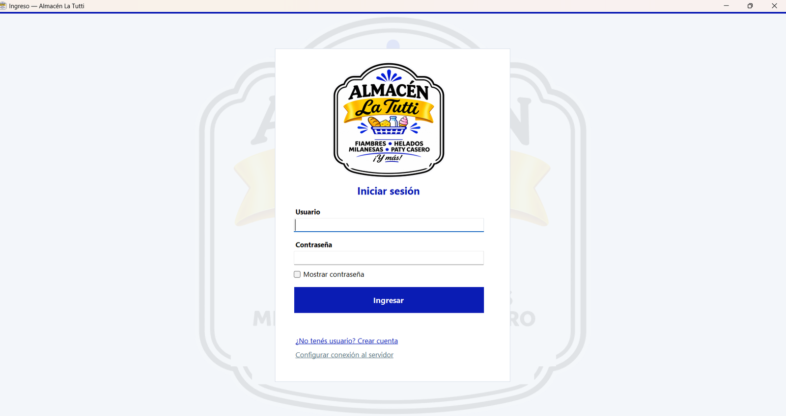
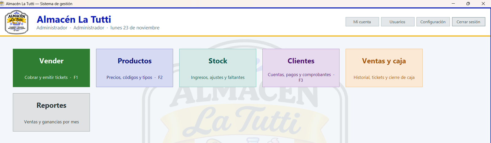
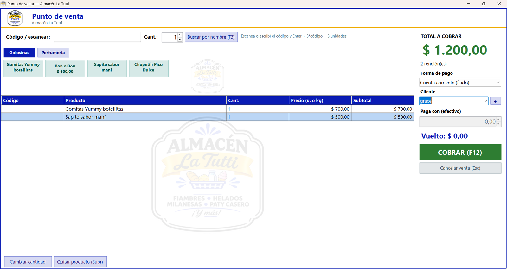
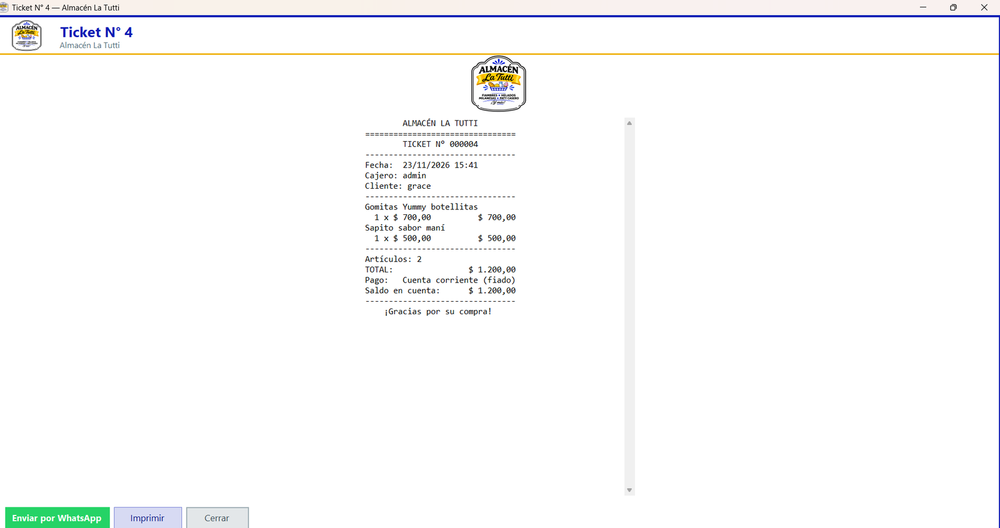
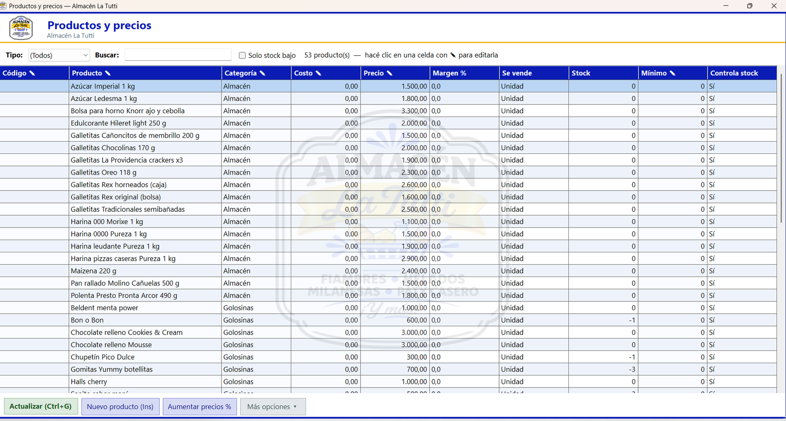
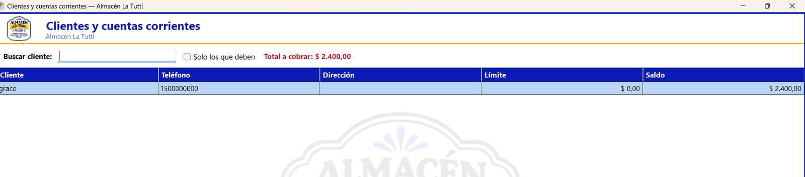
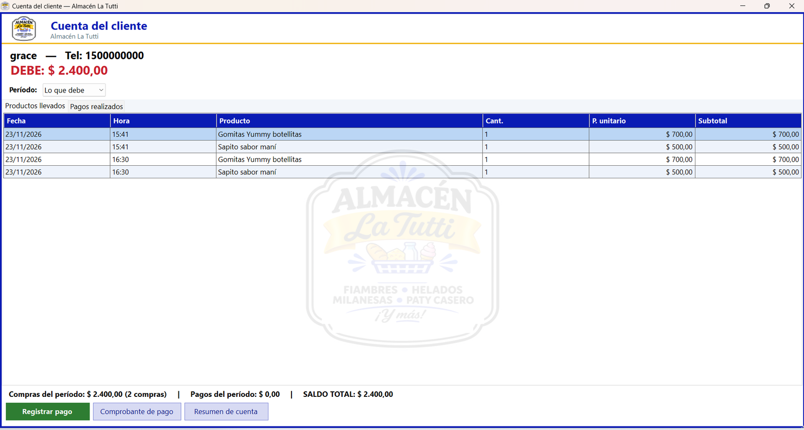
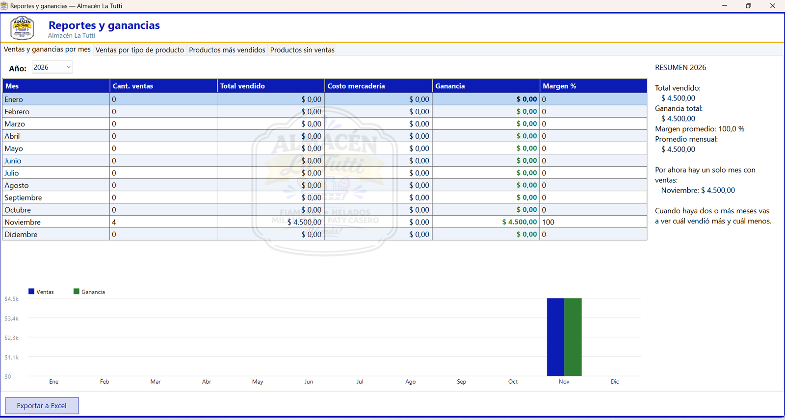
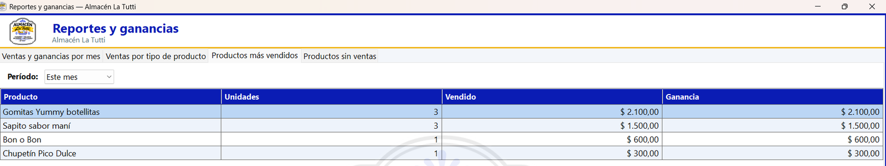
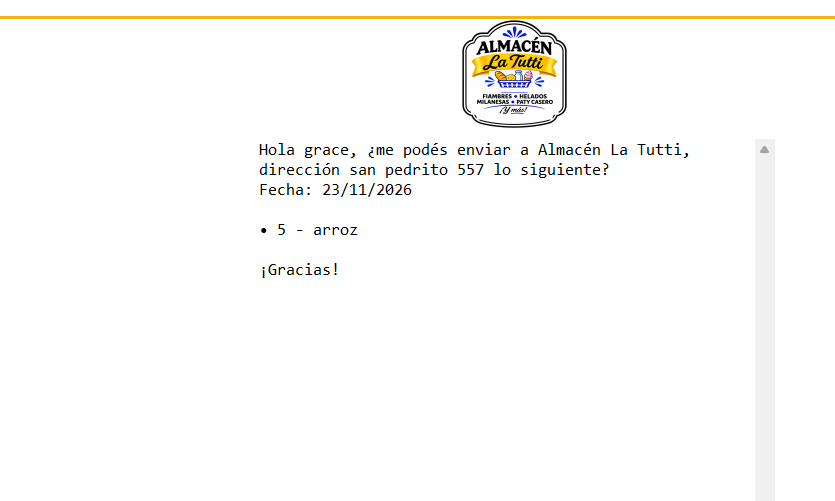

<p align="center">
  
</p>

<h1 align="center">Sistema de gestión para almacén y kiosco</h1>

<p align="center">
  Programa de escritorio para un comercio de barrio: ventas con lector de código de barras,
  control de stock, cuentas corrientes de clientes (fiado), pedidos a proveedores por WhatsApp
  y reportes de ventas y ganancias.
</p>

<p align="center">
  
  
  
</p>

---

## Sobre el proyecto

Lo desarrollé para **Almacén La Tutti**, un almacén real, a partir de las necesidades del día a día del negocio:
cobrar rápido escaneando productos, saber qué falta, llevar la cuenta de los clientes que compran fiado
y mandarles el resumen por WhatsApp, y ver a fin de mes cuánto se vendió y cuánto se ganó.

## Funcionalidades

| Módulo | Qué hace |
|---|---|
| **Ingreso** | Login con contraseña cifrada (PBKDF2), bloqueo tras 5 intentos, cambio de usuario y contraseña, creación de cuentas que el administrador aprueba. Roles **Administrador** y **Cajero**. |
| **Vender** | Escaneo de códigos de barras, búsqueda por nombre, botones rápidos para productos sin código, venta por kilo (fiambres, helado), cálculo de vuelto y 5 formas de pago. Al elegir un cliente pasa solo a **cuenta corriente**. |
| **Tickets** | Ticket con logo para impresora térmica de 58 u 80 mm, o envío por **WhatsApp Web** al cliente. |
| **Productos** | Edición directa en la grilla (precio, costo, código, mínimo), aumento masivo de precios por %, historial de precios, categorías y exportación a Excel. |
| **Stock** | Ingresos de mercadería, ajustes por conteo y bajas (roto o vencido), con historial de movimientos. Aviso de productos con poco stock. |
| **Clientes y fiado** | Saldo de cada cliente, productos llevados con fecha y hora, registro de pagos, límite de fiado y comprobante de pago por WhatsApp. |
| **Proveedores** | Agenda de proveedores y pedidos armados a mano que se envían por WhatsApp. |
| **Ventas y caja** | Historial de ventas, anulación (solo administrador) y cierre de caja por forma de pago. |
| **Reportes** | Ventas y ganancias por mes con gráfico, mes con más y menos ventas, ventas por tipo de producto, productos más vendidos y productos sin ventas. |
| **Configuración** | Datos del negocio, ancho del ticket, mensaje al pie y conexión a cada servidor MySQL desde una pantalla, sin tocar código. |

## Capturas

### Ingreso y menú principal



### Punto de venta y ticket



### Productos


### Clientes y cuenta corriente



### Reportes



### Pedido a proveedor por WhatsApp


> Las capturas usan datos de prueba.

## Tecnologías

- **C# / .NET 8** con **Windows Forms**
- **MySQL 8** con **MySql.Data**: consultas parametrizadas y transacciones en las ventas
- **GDI+** para el gráfico de barras y la impresión de tickets
- **Git y GitHub** para el control de versiones

## Cómo está organizado

```
Datos/          Acceso a la base de datos (un "Repo" por tabla)
Modelos/        Clases del negocio: Producto, Cliente, Venta...
Servicios/      Tickets, WhatsApp e impresión
Formularios/    Las pantallas
Diseno/         Colores, fuentes, logo y marco: todo el diseño en un solo lugar
Utilidades/     Controles y diálogos reutilizables
BaseDeDatos/    Scripts SQL para crear la base
```

Algunas decisiones de diseño:
- **El diseño está separado de la lógica**: cambiando `Diseno/Tema.cs` cambia el aspecto de todas las pantallas.
- **Un botón principal por pantalla**, y las acciones que se usan poco van en "Más opciones".
- **Las ganancias guardan el costo de cada producto al momento de la venta**, así un aumento posterior no cambia los números de meses anteriores.
- **Los clientes y proveedores no se borran**: se marcan como inactivos para no perder el historial.

## Cómo ejecutarlo

1. Instalar **Visual Studio 2022** (con "Desarrollo de escritorio de .NET") y **MySQL 8** o **XAMPP**.
2. Abrir `KioscoLaFamilia.sln` y apretar **F5**.
3. La primera vez aparece la pantalla **Conexión a la base de datos**: cargar los datos del servidor MySQL y tocar **Crear la base de datos**.
4. Ingresar con **admin / admin123** y cambiar la contraseña desde **Mi cuenta**.

El manual completo está en [docs/MANUAL.md](docs/MANUAL.md) y el análisis de requerimientos en [docs/ANALISIS.md](docs/ANALISIS.md).

## Autora

**Graciela** · [github.com/chelu314](https://github.com/chelu314)
